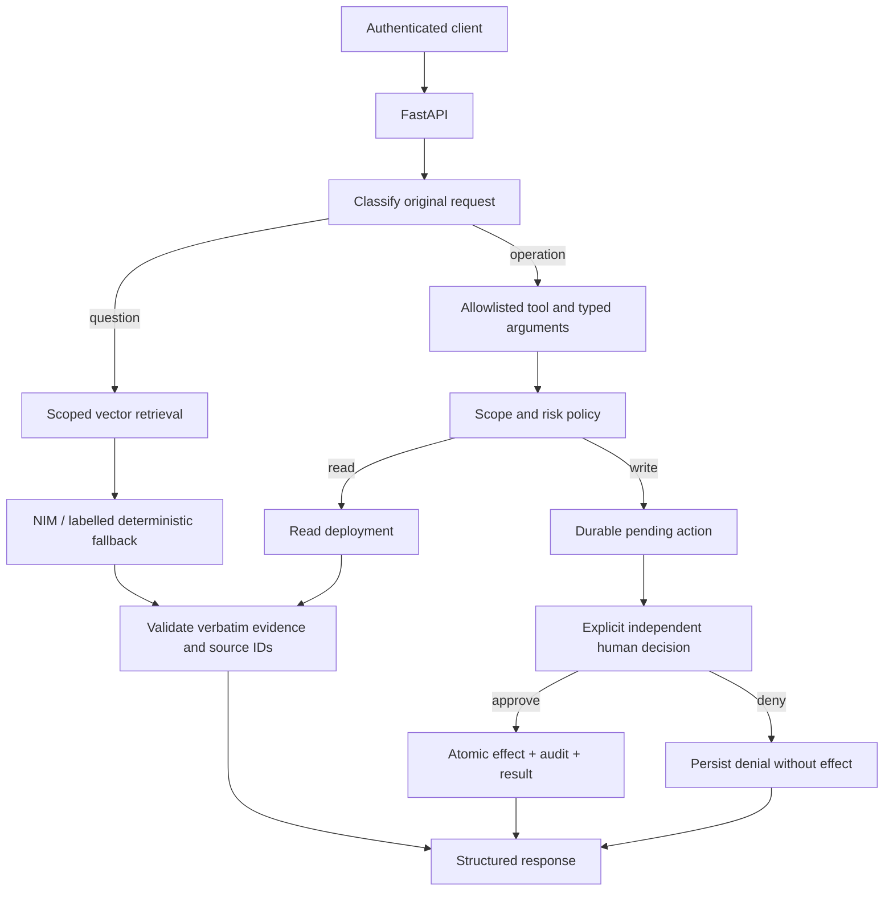
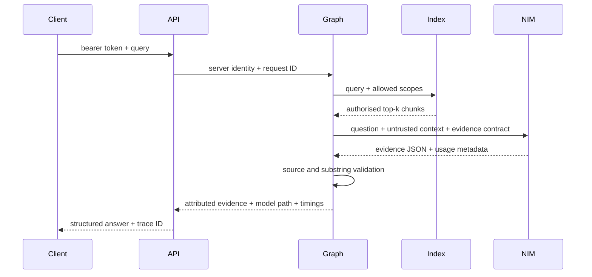
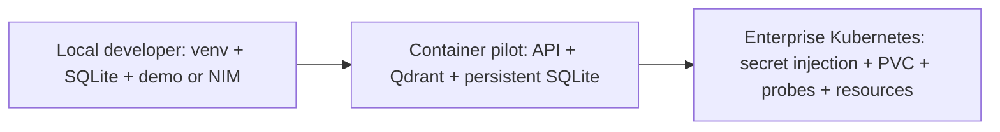

# Enterprise NIM agent architecture

This small reference runtime connects an authenticated FastAPI API to a bounded LangGraph
workflow, a configurable NVIDIA NIM client, scoped document retrieval, and operational tools.
It is an interview/demo reference, not a certified production service.

## Components and request flow

`app/api` owns request validation and bearer-token authentication. Identities and scopes come
from the server token configuration; callers cannot supply either in a query. Health endpoints
do not require authentication. All business endpoints do.

`app/agent` compiles an acyclic `StateGraph`. The state contains request/user/trace IDs, query,
request type, retrieved chunks, selected tool and validated arguments, approval state,
model metadata, output, errors and component timings. A recursion limit provides an additional
termination bound. The graph recognises a deliberately small operational grammar. Unsupported
or ambiguous actions fail closed. Use typed tool calls for precise client integrations.

`app/models` isolates NIM's OpenAI-compatible chat-completions transport. Environment variables
select endpoint, model, credentials, timeout and bounded exponential retries. Authentication,
invalid requests and malformed responses are permanent failures. Timeouts, connection errors,
408, 429 and server errors may retry; only explicitly retriable errors allow fallback. Every
answer records `primary`, `fallback` or `demo`. Offline extraction is never reported as NIM.

`app/retrieval` reconciles a manifest-controlled `.md`/`.txt` corpus, creates stable overlapping
chunks and metadata, embeds them with normalised deterministic hash vectors, and indexes them
in SQLite or Qdrant. Security filtering occurs in the backend before top-k; metadata is checked
again before returning context. Hash embeddings avoid downloads and are reproducible, but
lexical matching is weaker than semantic enterprise embeddings. Replace the embedding adapter
and rebuild the index when using a trained embedding model.
SQLite corpus replacement is atomic. Qdrant reconciliation deletes the previous corpus before
publishing replacements, so reclassification fails closed at the cost of a temporary
availability gap; an unsuccessful replacement leaves that corpus unavailable.

## Trust boundaries and output validation

API credentials never enter prompts. Model output and retrieved text are untrusted. Only the
original authenticated request can select an operational tool. The RAG model is asked for
structured evidence, not tool calls. Each returned quote must be a contiguous substring of an
authorised retrieved chunk, and its source ID must match that chunk. The API renders these
verified quotes with citations. Missing evidence produces an explicit unavailable answer;
invalid evidence produces a structured grounding error. This provides strong extractive
grounding at the cost of fluent abstractive summaries. It does not prove that a quote fully
answers the question or that the underlying source is correct. Conflicting numeric replica
requirements are flagged with both sources; arbitrary semantic conflicts need further work.
Selected substrings are expanded to their containing source sentence or line to preserve
nearby negation. Chunk boundaries can still limit context, so source review remains available.
The deterministic demo requires lexical coverage of meaningful query concepts and can abstain
on unseen synonyms. Use live NIM evaluation to assess model understanding separately.

## Tools and approvals

The registry exposes typed `get_deployment_status`, `update_deployment_status` and
`create_deployment_ticket` contracts. The `/mcp` endpoint uses JSON-RPC tools/list and
tools/call shapes inspired by MCP. It is a limited gateway, not a full MCP transport/session
implementation. A write call returns a pending approval instead of executing.

Pending actions retain canonical arguments, reason, requester, timestamp, scope information
and original correlation IDs. Approval requires a separate identity with decision and write
permissions plus access to the target project. No timeout, omitted decision or model response
grants approval. Missing explicit approval remains pending indefinitely.

SQLite `BEGIN IMMEDIATE` serialises competing decisions. The operational effect, decision,
audit and result commit in one transaction. Retries return the persisted result. Reusing a
request ID with another requester or different arguments is rejected. This exactly-once
guarantee applies to the local SQLite effects only. External APIs require receiver-supported
idempotency keys and/or a transactional outbox; this implementation does not imply atomic
exactly-once delivery to an external enterprise API.

## Telemetry and failure handling

OpenTelemetry spans cover inbound requests, graph execution, model calls, retrieval, tools
and decisions. They share trace and request correlation. Structured logs include IDs, status
and timings; prompts, retrieved text, tokens and provider response bodies are excluded.
OTLP HTTP export is optional. Responses include component latency, usage when the provider
supplies it, and optional token-price estimates supplied by the operator. TTFT is unavailable
for this non-streaming adapter; no GPU cost is inferred.

## Deployment progression

The container runs unprivileged and persists operational state. Compose includes Qdrant and
an optional OpenTelemetry Collector. Kubernetes and Helm use secret references, health
probes, resource limits and persistent storage. SQLite operational state requires a single
API replica with `Recreate` rollout; a PVC is not a distributed transaction manager. Move
operational state to a shared transactional database before adding replicas or an HPA.

TLS termination, identity-provider integration, network policies, backup/restore, document
classification, approver administration and model-serving capacity are enterprise integration
work. On-prem/hybrid deployments and a live GPU-serving NIM are not claimed as tested.
Dynamo is deliberately deferred: this outbound-client reference has no demonstrated
distributed inference scheduling requirement, so importing Dynamo would add no functional value.

References: [NVIDIA NIM API](https://docs.nvidia.com/nim/large-language-models/latest/api-reference.html),
[LangGraph StateGraph](https://reference.langchain.com/python/langgraph/graph/state).
